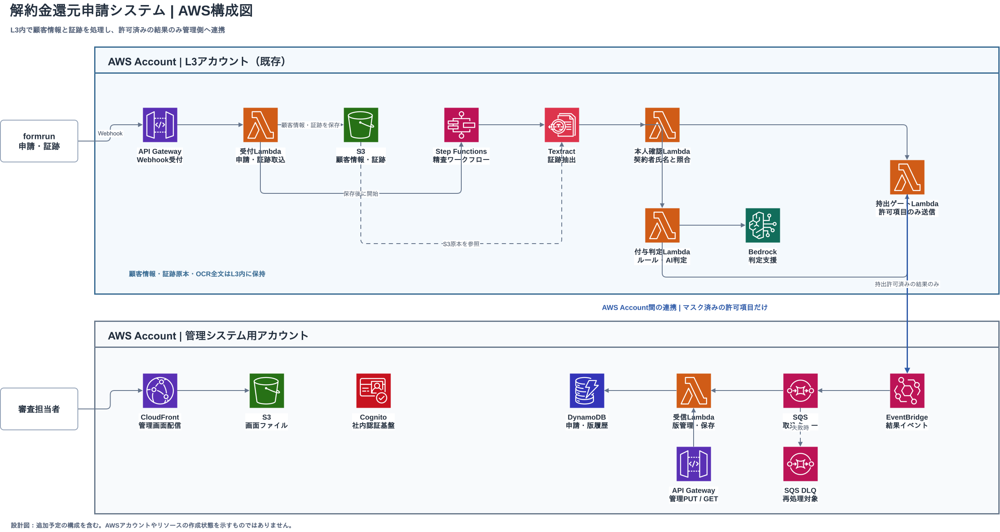

# L3環境 — point-l3

## 概要

他社解約金還元申請の顧客情報と証跡をL3アカウント内に保持し、証跡解析・本人確認・ポイント付与判定を行う。管理システムには、持出制御を通過した結果だけを連携する。


[SVG](docs/point-award-system-overview-with-screens.svg) ／ [HTML](docs/point-award-system-overview-with-screens.html)

## 1. 依存関係

| 名前 | バージョン |
|---|---|
| Git | 2.x |
| Docker / Docker Compose | Compose v2 |
| Terraform | 1.6.0以上 |
| AWS CLI | v2 |
| Swagger UI | 5.25.3 |

## 2. セットアップ

```bash
git clone https://github.com/takuto-san/point-l3.git
cd point-l3
docker compose up --build -d --wait
docker compose ps
bash scripts/terraform-generate.sh
cp terraform/terraform.tfvars.example terraform/terraform.tfvars
terraform -chdir=terraform init
terraform -chdir=terraform fmt -check
terraform -chdir=terraform validate
```

## 3. ディレクトリ構成

```text
point-l3/
├── README.md
├── l3-management.openapi.yaml
├── Dockerfile
├── docker-compose.yml
├── terraform/
│   └── README.md
├── scripts/
│   ├── terraform-generate.sh
│   └── terraform/templates/
│       ├── *.tf.tmpl
│       ├── terraform.tfvars.example.tmpl
│       └── .terraform.lock.hcl.tmpl
└── docs/
    ├── architecture-aws.drawio
    ├── architecture-aws.png
    ├── architecture-aws.svg
    ├── architecture.tvg.json
    ├── terravision.yml
    └── point-award-system-overview-with-screens.{html,png,svg}
```

## 4. AWS構成図



[draw.io](docs/architecture-aws.drawio) ／ [SVG](docs/architecture-aws.svg)
