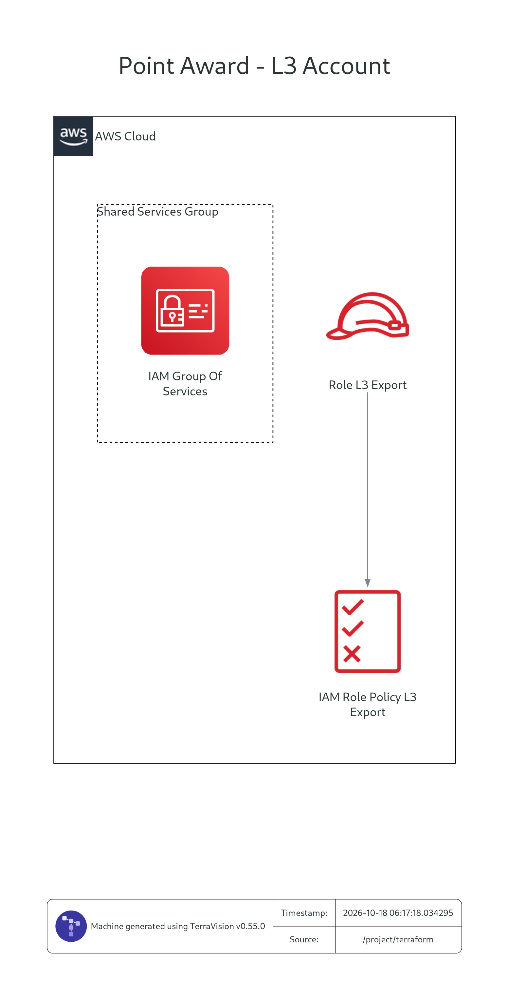

# L3環境 — point-l3

他社解約金還元申請の証跡・個人情報をL3内で扱い、本人確認とポイント付与判定を支援する側のリポジトリ。管理システムは [point](https://github.com/takuto-san/point) で管理する。

設計の基準は「管理システム」チャットの最新の全体像・画面仕様。証跡精査の工数を月約30時間削減し、7日以内に審査結果を通知することを業務目標とする。現時点でこのリポジトリにあるAWSリソース定義は、管理側へ結果を送るIAMロール・ポリシーのみ。

## 環境セットアップ

### 必要なツール

| ツール | 用途 |
|---|---|
| Git | ソースの取得 |
| Docker / Docker Compose v2 | Swagger UIとdraw.io構成図の再生成。Docker Desktop等を起動しておく |
| Terraform 1.6以上 | L3用AWS構成の初期化・検証・構築を行う場合のみ |
| AWS CLI v2 | AWSへ接続・構築する場合のみ |

Swagger UIの閲覧・draw.io構成図の再生成に、ホスト側のPythonやAWSアカウント・認証情報は不要。初回はDockerイメージの取得にネット接続が必要。このリポジトリには実行アプリやNode.jsテストがないため、Node.jsの導入・`npm install` も不要。

### 1. リポジトリを取得する

```bash
git clone https://github.com/takuto-san/point-l3.git
cd point-l3
```

以下のコマンドは、特記がない限りリポジトリのルートで実行する。

### 2. Swagger UIを起動する

```bash
docker compose up --build -d --wait
docker compose ps
```

[http://localhost:8081](http://localhost:8081) を開く。これは管理側のAPI契約を閲覧するUIで、L3のWebhook/API本体のローカル起動ではない。停止する場合は `docker compose down` を実行する。ポートが重複する場合は `SWAGGER_PORT=18081 docker compose up --build -d --wait` で変更できる。

### 3. AWS構成を設定・検証する場合

初回のみ設定例をコピーし、`terraform/terraform.tfvars` を編集する。既存の設定ファイルがある場合はコピーを省略する。

```bash
cp terraform/terraform.tfvars.example terraform/terraform.tfvars
terraform -chdir=terraform init
terraform -chdir=terraform fmt -check
terraform -chdir=terraform validate
```

| 設定項目 | 設定する値 |
|---|---|
| `l3_aws_profile` | L3アカウント用AWSプロファイル名。例：`l3-dev` |
| `l3_account_id` | 適用先L3アカウントの12桁ID。point側の同名変数と一致させる |
| `management_event_bus_arn` | pointのTerraform出力から取得する管理側イベントバスARN |
| `aws_region` | 管理側EventBridgeと同じリージョン。初期値：`ap-northeast-1` |

設定例のアカウントID・イベントバスARNは仮の値なので、構築前に実環境の値へ置き換える。`init` はプロバイダ取得のためネット接続が必要だが、`validate` までの手順にAWS認証情報は不要。`terraform.tfvars` とstateはGit管理対象外。

### 4. AWSへ接続・構築する場合

構築順序は **point（管理側）→ point-l3（L3側）**。先に [pointの環境セットアップ](https://github.com/takuto-san/point#環境セットアップ) に従って管理側を構築し、イベントバスARNを取得する。隣接してチェックアウトしている場合は、以下で確認できる。

```bash
terraform -chdir=../point/terraform output -raw management_event_bus_arn
```

取得した値を `terraform/terraform.tfvars` の `management_event_bus_arn` へ設定する。隣接チェックアウトがない場合は、管理側の担当者からARNを受け取って設定してもよい。

組織の認証手順に従ってL3アカウント用プロファイルを用意し、`l3_aws_profile` と同じ名前で認証する。例の `l3-dev` は実際の名前に置き換える。

```bash
aws sts get-caller-identity --profile l3-dev
terraform -chdir=terraform plan -var-file=terraform.tfvars
```

表示されたアカウントIDと `l3_account_id` が一致することを確認する。AWSリソースを構築する場合は、planの内容を確認してから実行する。

```bash
terraform -chdir=terraform apply -var-file=terraform.tfvars
terraform -chdir=terraform output -raw l3_export_role_arn
```

出力は将来の送信Lambdaへ割り当てる実行ロールのARN。現在はIAMロール・ポリシーの構築までで、Webhook・OCR・送信Lambda本体は起動しない。

## システム概要

「管理システム」チャットでCodexのdiagram-designを使って作成した、全体構成と画面仕様の図。両リポジトリで同じ図を掲載し、L3側と管理側の役割を共有する。L3の受付・解析・持出審査・送信コードは未実装。


[SVG版](docs/point-award-system-overview-with-screens.svg) ／ [編集用HTML](docs/point-award-system-overview-with-screens.html)

システム概要図は既存図を内容変更せず掲載している。AWSサービスの配置は、下の共通AWS構成図でL3内のTextract・Bedrock・本人確認Lambdaとして具体化した。実装済み／未実装の区分は下の表を参照。

L3側の処理方針：

1. formrunのWebhookを起点に申請・証跡を取り込み、L3内で保持する。Webhookの実際のペイロードと証跡取得方式は未確定。
2. L3内のTextract・Bedrockで証跡解析・判定支援を行い、本人確認Lambdaで回線契約者氏名と照合する。本人確認とポイント付与判定は別々に実行する。Textractの日本語証跡対応は下記の検証事項を参照。
3. 本人確認は回線契約者の氏名と照合し、ポイント付与判定は営業・運用部門で確認済みのルールを参照する。AIの判定出力は「結果・理由」のみ。
4. 完了した結果を持出審査・マスク処理に通し、版付きスナップショットで管理側へ順次送る。
5. 担当者による「結果・理由」の修正と「確定」、メールリストの連携、配信完了後のマイページ結果更新は管理側が担当する。

原本・未マスクの個人情報・OCR全文・メールアドレスは管理系へ渡さない。マスク済み比較情報やNIFTY IDも、持出許可がある項目だけを送る。担当者が原本を確認する導線は「formrunで開く」とする。

| 業務イベント | マイページの表示 |
|---|---|
| formrunで申請受付 | 受付済み |
| 申請管理システムへの取込 | 審査中 |
| メール配信完了を連携 | 結果 |

マイページは既存の独立した表示先とし、メール送信可能になった時点ではなく、配信完了後に結果を公開する。ポイント実付与はこの全体像に含めない。

## AWS構成図

point / point-l3 の両リポジトリに、以下の同一画像を掲載する。既存の **L3アカウント** と管理システム用アカウントを、AWS Accountの枠で分離した全体設計図。



[draw.io編集用ファイル](docs/architecture-aws.drawio) ／ [SVG版](docs/architecture-aws.dot.svg) ／ [Terravision設計定義](docs/architecture.tvg.json)

編集用の `.drawio` はAWS4サービスアイコンと編集可能なAWS Account枠・矢印で構成する。[AWSの図作成記事](https://aws.amazon.com/blogs/machine-learning/build-aws-architecture-diagrams-using-amazon-q-cli-and-mcp/) が示すサービス・接続・境界の整理を、draw.io形式に合わせて適用した。画像は同じ設計定義から生成したTerravisionのプレビュー。

- **L3アカウント（既存）**：Webhook受付 → 受付Lambda → S3へ顧客・申請・証跡データを保存。保存後にStep Functionsで精査を開始し、Textract、本人確認Lambda、付与判定Lambda、Bedrock、持出ゲート・送信LambdaをL3内で利用する。
- **本人確認Lambda**：抽出した氏名とL3内の回線契約者情報を照合し、結果・理由を返す。回線契約情報の取得元・接続方式は詳細設計で確定する。Webhookを保存するS3を、照合用の正しい回線契約情報の取得元と同一視しない。
- **管理アカウント**：持出許可済み結果をEventBridge → SQS → 受信Lambda → DynamoDBへ保存する。CloudFront・画面配信用S3・Cognito・管理側APIもこのアカウントに置く。

L3の顧客情報・証跡原本・OCR全文は管理アカウントへ送らず、ゲートで許可した識別子・マスク情報・判定・理由・金額だけを連携する。

この図は実装済みと追加予定の構成を含む**設計図**で、Terraform planや実環境のスキャン結果ではない。既存のL3アカウントを新規作成するものではなく、アカウント枠はデータ処理・権限の境界を表す。現在のL3用Terraformは送信用IAMのみで、Webhook受付・保存・解析・本人確認のコードやリソース定義は別途実装する。

Textractは図のとおりL3内で利用する想定。ただし、[AWS公式の対応言語](https://docs.aws.amazon.com/textract/latest/dg/limits-document.html) に日本語は含まれないため、日本語証跡のOCRは補完・代替方式を含めて検証が必要。Bedrockのモデル・判定ルールも詳細設計で確定する。

## ディレクトリ構成

```text
point-l3/
├── README.md
├── Dockerfile                         # API契約閲覧用のSwagger UI
├── docker-compose.yml                 # localhost:8081
├── .dockerignore
├── .gitignore                         # state・ローカル設定等を除外
├── openapi/
│   └── l3-management.openapi.yaml      # 管理側受信APIの契約コピー
├── terraform/
│   ├── versions.tf                    # Terraform・AWSプロバイダのバージョン
│   ├── providers.tf                   # L3アカウントへの接続
│   ├── variables.tf                   # アカウントID・送信先ARN等
│   ├── l3.tf                          # 送信用IAMロール・ポリシー
│   ├── outputs.tf                     # l3_account_id・l3_export_role_arn
│   ├── terraform.tfvars.example        # 設定例
│   └── .terraform.lock.hcl             # AWSプロバイダの固定
├── tools/
│   ├── diagram.sh                     # 共通AWS設計図の再生成（両リポジトリ共通）
│   ├── diagram-drawio.py              # 編集可能なdraw.io図を生成
│   ├── diagram-preview.sh             # TerravisionのPNG/SVGプレビューを生成
│   ├── diagram-terraform.sh           # このリポジトリのTerraformだけを図示
│   ├── diagram-providers.tf.txt        # Terraform図用の仮プロバイダ設定
│   ├── terravision.Dockerfile          # 日本語フォント対応の描画環境
│   └── terravision-services.pth        # Textract/Bedrockの公式サービスアイコン名
└── docs/
    ├── architecture.tvg.json           # 両アカウントの共通設計図
    ├── architecture-aws.drawio          # AWS4アイコンで編集可能な共通図
    ├── terravision.yml                 # 日本語ラベル・連携ラベル
    ├── architecture-aws.dot.png
    ├── architecture-aws.dot.svg
    ├── point-award-system-overview-with-screens.png
    ├── point-award-system-overview-with-screens.svg
    └── point-award-system-overview-with-screens.html
```

生成物・ローカル設定の `.terraform/`、state、`terraform.tfvars` はGit管理対象外。管理側の受信API本体・Lambda・DBはpointに置き、AWS構成図の生成ツールは各リポジトリに置く。

## 実装状況とリポジトリの分担

| 項目 | 担当 | 現在の状態 |
|---|---|---|
| 結果送信用IAMロール・EventBridge送信権限 | point-l3 | Terraform定義あり |
| 管理側API・共通AnalysisSnapshotの契約 | pointが正本、point-l3がコピー | OpenAPIあり |
| formrun Webhook受付・証跡取得・保存 | point-l3 | 未実装 |
| OCR・本人確認・ポイント付与判定 | point-l3 | 未実装。L3内のTextract・Bedrock・本人確認Lambdaで設計。モデル・業務ルール等は要確定 |
| マスク・持出審査・版採番・結果送信 | point-l3 | 未実装 |
| EventBridge・SQS・受信Lambda・DynamoDB | point | 定義・受信コードあり |
| 管理画面、修正・確定API、メール・マイページ連携 | point | 未実装 |

## 管理側との接続

point側の `l3_account_id` と本リポジトリの `l3_account_id`、送信先のリージョンを揃える。AWSプロバイダは `allowed_account_ids` でL3への適用を検証する。stateは両リポジトリで独立し、互いのstateや隣接チェックアウトへの実行時依存はない。

出力 `l3_export_role_arn` を送信Lambdaの実行ロールに設定する際は、ログ・L3データ等の必要な権限を送信Lambdaの実装側で追加する。

## API契約の同期

起動手順は上部の「環境セットアップ」を参照。契約の正本は [pointのOpenAPI](https://github.com/takuto-san/point/blob/main/openapi/l3-management.openapi.yaml) で、[このリポジトリのコピー](openapi/l3-management.openapi.yaml) はv0.2.0。契約更新時は両リポジトリを同じ内容に保つ。

```bash
# 隣接チェックアウトでの契約更新例
cp ../point/openapi/l3-management.openapi.yaml openapi/l3-management.openapi.yaml
```

通常の結果送信はEventBridgeを使用する。イベントの `source` は `jp.co.nifty.point-award.l3`、`detail-type` は `AnalysisSnapshot.v1`、`detail` はOpenAPIの `AnalysisSnapshot` とする。`applicationId` と単調増加する `revision` で再送・順序逆転に対応し、各版には差分ではなく全状態を含める。

OpenAPIのPUT/GETは管理側が提供するIAM認可の受信・受信票API。現在のTerraformはL3からの直接クロスアカウントHTTPS呼び出し権限を付与しない。

## 移設済み環境について

元の `point/terraform/l3.tf` のIAMロール・ポリシーを移設し、リソース名を維持した。送信先は管理側リソースの直接参照から入力変数へ変更している。既存環境で旧構成を適用済みの場合は、L3リソースのstateをこのリポジトリへ移管してから両方のplanを確認する。

## AWS構成図の再生成

```bash
bash tools/diagram.sh
```

Dockerのみ必要。コンテナ内のPythonで共通の `docs/architecture.tvg.json` を読み込み、AWS4アイコンを使った編集可能な `docs/architecture-aws.drawio` を生成する。ホストにPythonをインストールする必要はない。Textract/Bedrockはサービス利用を示す図用の型で、Terraformリソースの作成を意味しない。

両リポジトリの設計定義・生成スクリプト・draw.ioファイルを同一に保つ。`.drawio` は [diagrams.net](https://app.diagrams.net/) の「ファイルを開く」から編集できる。

READMEに表示するPNG/SVGプレビューを再生成する場合は、Dockerを起動して `bash tools/diagram-preview.sh` を実行する。Terravision 0.55.0を使うため、プレビューの配置はdraw.io編集画面と異なる。両リポジトリの画像を同一に保つときは一方で生成してコピーする。描画日時が画像に入るため、個別生成ではバイト単位で一致しない。

このリポジトリのTerraformだけを図示する場合は `bash tools/diagram-terraform.sh` を使う（Terraformも必要）。出力名は `terraform-architecture-aws.dot.png` / `.svg` で、READMEの共通図を上書きしない。いずれの図生成手順もAWSの作成・変更は行わない。
