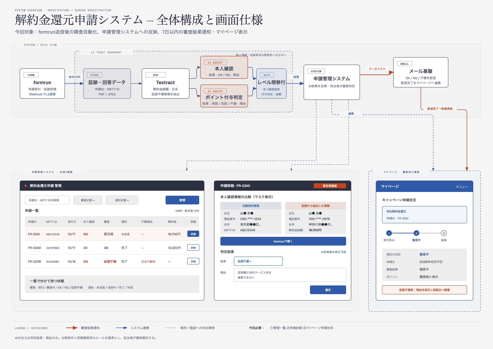

# L3環境

## 概要

他社解約金還元申請の顧客情報と証跡をL3アカウント内に保持し、証跡解析・本人確認・ポイント付与判定を行う。管理システムには、持出制御を通過した結果だけを連携する。



## 1. 依存関係

| 名前 | バージョン |
|---|---|
| Docker / Docker Compose | Compose v2 |
| Terraform | 1.6.0以上 |
| AWS CLI | v2 |
| Swagger UI | 5.25.3 |
| Diagram-as-Code (`awsdac`) | v0.23 |

## 2. セットアップ

```bash
git clone https://github.com/takuto-san/point-l3.git
cd point-l3
docker compose up --build -d --wait
docker compose ps
cp terraform/terraform.tfvars.example terraform/terraform.tfvars
terraform -chdir=terraform init
terraform -chdir=terraform fmt -check
terraform -chdir=terraform validate
awsdac terraform/aws-architecture.yml --output diagrams/aws-architecture.png --force
```

## 3. ディレクトリ構成

```text
point-l3/
├── README.md
├── openapi.yml
├── Dockerfile
├── docker-compose.yml
├── terraform/
│   ├── README.md
│   ├── *.tf
│   ├── aws-architecture.yml
│   └── terraform.tfvars.example
└── diagrams/
    ├── aws-architecture.png
    └── system-overview.png
```

## 4. AWS構成図


この図は目標構成です。VPC・AZ・サブネットとLambdaのVPC接続は現時点のTerraformには未実装です。
