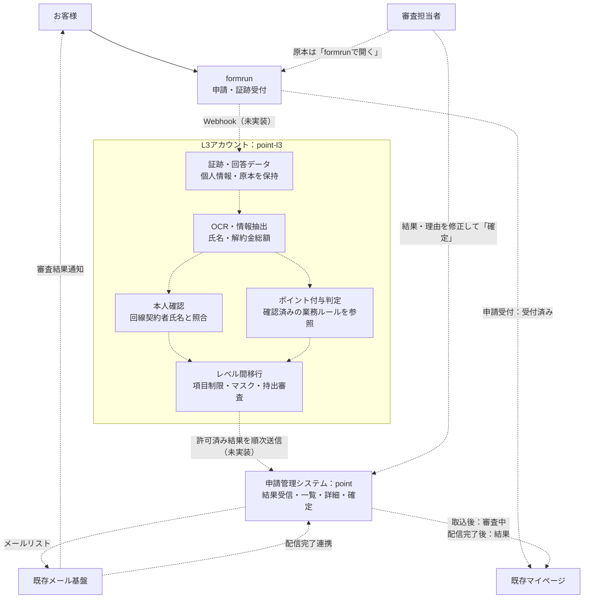
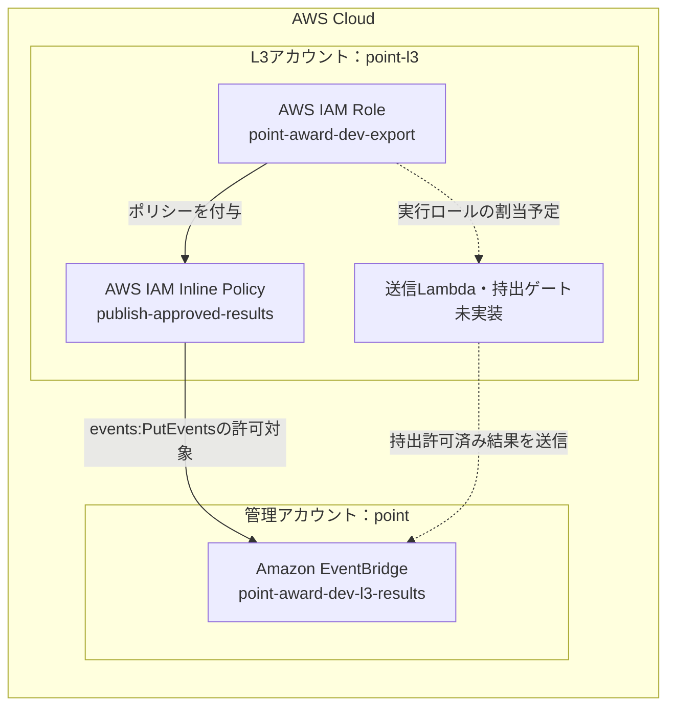

# L3環境 — point-l3

他社解約金還元申請の証跡・個人情報をL3内で扱い、本人確認とポイント付与判定を支援する側のリポジトリ。管理システムは [point](https://github.com/takuto-san/point) で管理する。

設計の基準は「管理システム」チャットの最新の全体像・画面仕様。証跡精査の工数を月約30時間削減し、7日以内に審査結果を通知することを業務目標とする。現時点でこのリポジトリにあるAWSリソース定義は、管理側へ結果を送るIAMロール・ポリシーのみ。

## システム連携図

以下は完成時の全体像。破線は、この2リポジトリにまだ実装されていない処理・業務連携を示す。L3内の受付・保存・解析・持出審査・送信コードは未実装で、管理側は結果受信・保存まで実装している。



L3側の処理方針：

1. formrunのWebhookを起点に申請・証跡を取り込み、L3内で保持する。Webhookの実際のペイロードと証跡取得方式は未確定。
2. OCR等で氏名・解約金総額を抽出し、本人確認とポイント付与判定を別々に実行する。OCR/AIサービスは未選定。
3. 本人確認は回線契約者の氏名と照合し、ポイント付与判定は営業・運用部門で確認済みのルールを参照する。AIの判定出力は「結果・理由」のみ。
4. 完了した結果を持出審査・マスク処理に通し、版付きスナップショットで管理側へ順次送る。
5. 担当者による「結果・理由」の修正と「確定」、メールリストの連携、配信完了後のマイページ結果更新は管理側が担当する。

原本・未マスクの個人情報・OCR全文・メールアドレスは管理系へ渡さない。マスク済み比較情報やNIFTY IDも、持出許可がある項目だけを送る。担当者が原本を確認する導線は「formrunで開く」とする。

| 業務イベント | マイページの表示 |
|---|---|
| formrunで申請受付 | 受付済み |
| 申請管理システムへの取込 | 審査中 |
| メール配信完了を連携 | 結果 |

マイページは既存の独立した表示先とし、メール送信可能になった時点ではなく、配信完了後に結果を公開する。ポイント実付与はこの全体像に含めない。

## AWS構成図

現在のL3用TerraformはIAMロールとインラインポリシーの2リソースだけを定義する。実線はTerraformで定義した権限関係、破線は未実装の送信処理との接続予定。送信先EventBridgeは管理側のリソースで、ここでは作成しない。



図のリソース名はデフォルト設定の例。ロールの信頼先は `lambda.amazonaws.com`、送信権限は入力変数 `management_event_bus_arn` のイベントバスだけに限定する。L3アカウント内の送信許可と、管理アカウント側のイベントバスポリシーの両方で接続する。

API Gateway、証跡用S3・DB、OCR/AI、送信LambdaはまだTerraformに含まれていない。IAMロールを作成しただけでは、formrunから結果送信までの処理は動作しない。VPC・サブネット・NATも現在の構成には含めていない。

## ディレクトリ構成

```text
point-l3/
├── README.md
├── Dockerfile                         # API契約閲覧用のSwagger UI
├── docker-compose.yml                 # localhost:8081
├── .dockerignore
├── .gitignore                         # state・ローカル設定等を除外
├── openapi/
│   └── l3-management.openapi.yaml      # 管理側受信APIの契約コピー
└── terraform/
    ├── versions.tf                    # Terraform・AWSプロバイダのバージョン
    ├── providers.tf                   # L3アカウントへの接続
    ├── variables.tf                   # アカウントID・送信先ARN等
    ├── l3.tf                          # 送信用IAMロール・ポリシー
    ├── outputs.tf                     # l3_account_id・l3_export_role_arn
    ├── terraform.tfvars.example        # 設定例
    └── .terraform.lock.hcl             # AWSプロバイダの固定
```

生成物・ローカル設定の `.terraform/`、state、`terraform.tfvars` はGit管理対象外。管理側の受信API本体・Lambda・DB・構成図生成ツールはpointに置く。

## 実装状況とリポジトリの分担

| 項目 | 担当 | 現在の状態 |
|---|---|---|
| 結果送信用IAMロール・EventBridge送信権限 | point-l3 | Terraform定義あり |
| 管理側API・共通AnalysisSnapshotの契約 | pointが正本、point-l3がコピー | OpenAPIあり |
| formrun Webhook受付・証跡取得・保存 | point-l3 | 未実装 |
| OCR・本人確認・ポイント付与判定 | point-l3 | 未実装。サービス・業務ルールの確定が必要 |
| マスク・持出審査・版採番・結果送信 | point-l3 | 未実装 |
| EventBridge・SQS・受信Lambda・DynamoDB | point | 定義・受信コードあり |
| 管理画面、修正・確定API、メール・マイページ連携 | point | 未実装 |

## Terraformの設定・検証

pointの管理側Terraformを先に適用し、出力 `management_event_bus_arn` を取得する。

```bash
# point-l3から、隣接しているpointの出力を取得する例
terraform -chdir=../point/terraform output -raw management_event_bus_arn

cp terraform/terraform.tfvars.example terraform/terraform.tfvars
```

`terraform/terraform.tfvars` の `l3_aws_profile`、`l3_account_id`、`management_event_bus_arn` を実環境の値に変更する。

```bash
terraform -chdir=terraform init
terraform -chdir=terraform fmt -check
terraform -chdir=terraform validate
terraform -chdir=terraform plan -var-file=terraform.tfvars
```

point側の `l3_account_id` と本リポジトリの `l3_account_id` を一致させる。リージョンも送信先EventBridgeと揃える。AWSプロバイダは `allowed_account_ids` でL3への適用を検証する。stateは両リポジトリで独立し、互いのstateや隣接チェックアウトへの実行時依存はない。

出力 `l3_export_role_arn` を送信Lambdaの実行ロールに設定する際は、ログ・L3データ等の必要な権限を送信Lambdaの実装側で追加する。このロール単独ではLambdaをデプロイしない。

## API契約の閲覧・同期

```bash
docker compose up --build -d
# http://localhost:8081
```

Swagger UIは送信先のAPI仕様閲覧用。L3が提供するWebhook/APIの実装ではない。正本は [pointのOpenAPI](https://github.com/takuto-san/point/blob/main/openapi/l3-management.openapi.yaml) で、[このリポジトリのコピー](openapi/l3-management.openapi.yaml) はv0.2.0。契約更新時は両リポジトリを同じ内容に保つ。

```bash
# 隣接チェックアウトでの契約更新例
cp ../point/openapi/l3-management.openapi.yaml openapi/l3-management.openapi.yaml
```

通常の結果送信はEventBridgeを使用する。イベントの `source` は `jp.co.nifty.point-award.l3`、`detail-type` は `AnalysisSnapshot.v1`、`detail` はOpenAPIの `AnalysisSnapshot` とする。`applicationId` と単調増加する `revision` で再送・順序逆転に対応し、各版には差分ではなく全状態を含める。

OpenAPIのPUT/GETは管理側が提供するIAM認可の受信・受信票API。現在のTerraformはL3からの直接クロスアカウントHTTPS呼び出し権限を付与しない。

## 移設済み環境について

元の `point/terraform/l3.tf` のIAMロール・ポリシーを移設し、リソース名を維持した。送信先は管理側リソースの直接参照から入力変数へ変更している。既存環境で旧構成を適用済みの場合は、L3リソースのstateをこのリポジトリへ移管してから両方のplanを確認する。
